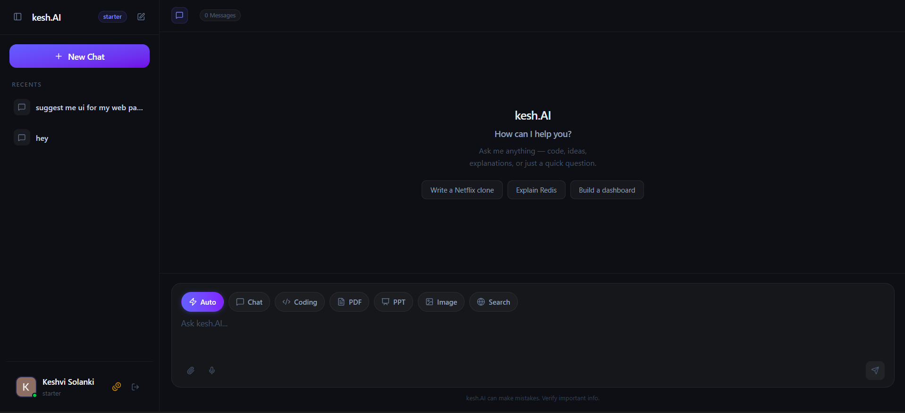
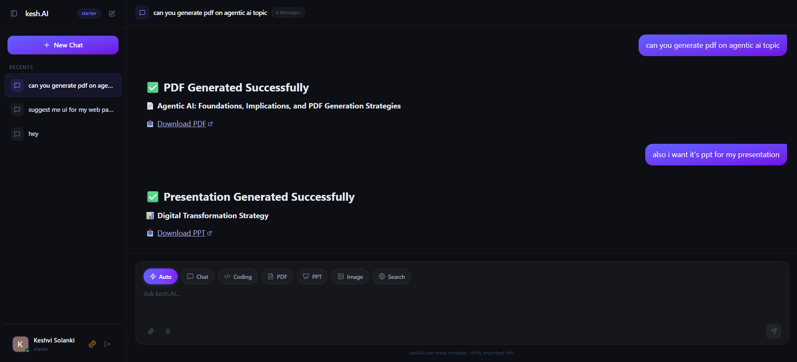
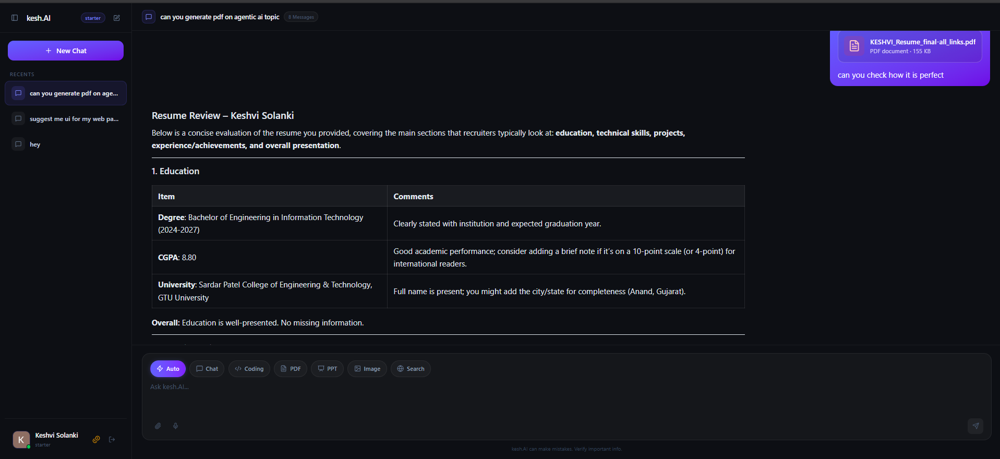
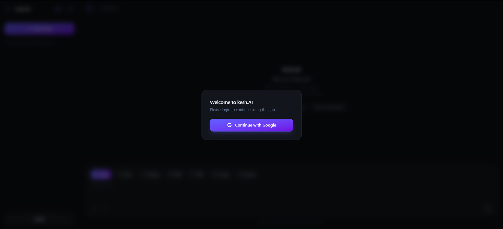
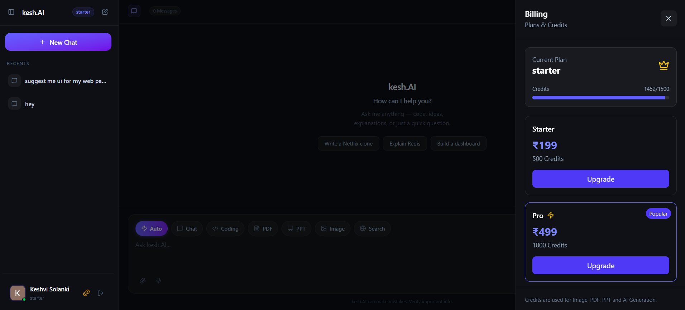

# 🚀 KeshAI — Agentic AI & Generative AI Assistant

<p align="center">
  <strong>An intelligent AI workspace for chatting, coding, researching, and creating.</strong>
</p>

<p align="center">
  A full-stack AI application combining Generative AI, Agentic AI workflows, RAG, and a MERN microservices architecture.
</p>

<p align="center">
  <a href="YOUR_CURRENT_CLOUDFLARE_URL"><strong>🌐 Try KeshAI Demo</strong></a>
  &nbsp; • &nbsp;
  <a href="https://github.com/keshviSolanki/KeshAI"><strong>💻 GitHub Repository</strong></a>
</p>

---

## 🌟 About KeshAI

**KeshAI** is an AI-powered intelligent assistant that combines **Generative AI, Agentic AI, and Retrieval-Augmented Generation (RAG)** to provide multiple AI capabilities through a single platform.

Built using the MERN stack and a microservices architecture, KeshAI integrates Large Language Models (LLMs), AI workflows, vector databases, and external tools to support intelligent conversations, coding assistance, document analysis, web research, and AI-powered content generation.

The project explores how LLMs can go beyond simple text generation by incorporating contextual retrieval, tool integration, and multi-step AI workflows.

KeshAI brings together modern AI engineering concepts and scalable backend development in one application.

## 🧠 AI Concepts & Engineering

KeshAI focuses on practical implementations of modern AI application development.

### 1. Generative AI (GenAI)

Generative AI enables the application to generate human-like responses and AI-powered content using Large Language Models.

Concepts and capabilities:

- Large Language Models (LLMs).
- Prompt engineering and context management.
- AI-powered conversational interfaces.
- Text and code generation.
- AI-assisted document and presentation generation.
- Integration with external AI model providers.
- Multimodal AI workflows where supported.

### 2. Agentic AI

Agentic AI focuses on building AI systems that can use tools and perform multiple steps to accomplish a task rather than only generating a single response.

KeshAI explores agent-based AI application workflows using LangChain and LangGraph.

Key concepts:

- AI agents and agent workflows.
- Tool calling and tool selection.
- Multi-step task execution.
- Context-aware AI interactions.
- Workflow orchestration.
- Integration with external tools and services.
- Agent-based assistance for research and coding tasks.

### 3. Retrieval-Augmented Generation (RAG)

RAG combines information retrieval with LLM generation to provide responses grounded in relevant external documents.

KeshAI integrates a document retrieval workflow using embeddings and Qdrant.

Key concepts:

- Document ingestion and processing.
- Text chunking.
- Embedding generation.
- Vector database storage.
- Semantic similarity search.
- Context retrieval.
- LLM-powered question answering using retrieved information.

### 4. AI Tool Integration

The application integrates external services to extend AI capabilities.

Examples include:

- AI model providers.
- Web search integrations.
- Vector search.
- Document processing.
- File storage.
- AI-powered content generation.

---

## ✨ Features

### 🤖 Intelligent AI Assistant
- Conversational AI interface.
- LLM-powered responses.
- Context-aware interactions.
- Coding and programming assistance.
- AI-powered content generation.

### 🧠 Agentic AI Workflows
- AI agent-based workflows.
- Tool integration and calling.
- Multi-step task execution.
- LangChain and LangGraph integration.
- AI-assisted research and problem-solving.

### 📚 RAG & Document Intelligence
- PDF upload and processing.
- Document-based question answering.
- Embedding generation.
- Qdrant vector search.
- Context retrieval for AI responses.

### 🌐 AI Research & Multimodal Capabilities
- Web research through supported search integrations.
- Image input workflows.
- AI image generation through supported providers.
- Document and presentation generation.

### 🔐 Authentication & User Management
- Google authentication using Firebase.
- Backend user verification.
- User-specific conversations.
- Redis-based session management.

### 💳 Subscription & Credit Management
- Credit-based AI usage.
- Free and paid subscription plans.
- Razorpay payment integration.

### 🏗️ Backend Engineering
- Microservices architecture.
- Centralized API gateway.
- Independent backend services.
- MongoDB integration.
- Redis session and caching workflows.
- External API integrations.

---

## 🛠️ Technology Stack

| Category | Technologies |
|---|---|
| Frontend | React, Vite, JavaScript |
| Styling | Tailwind CSS |
| State Management | Redux Toolkit |
| API Communication | Axios |
| Backend | Node.js, Express.js |
| Architecture | Microservices |
| Database | MongoDB, MongoDB Atlas |
| Session & Caching | Redis, ioredis |
| Authentication | Firebase Authentication, Firebase Admin SDK |
| Generative AI | Large Language Models, OpenRouter, supported AI models |
| Agentic AI | LangChain, LangGraph, AI Agents |
| RAG | Embeddings, Document Processing, Semantic Retrieval |
| Vector Database | Qdrant |
| Web Research | Tavily integration |
| File Storage | AWS S3 |
| Payments | Razorpay |
| Public Demo | Cloudflare Quick Tunnel |

*Some integrations and capabilities depend on provider configuration, API credentials, and service availability.*

---

## 🏛️ System Architecture

KeshAI follows a microservices architecture. The frontend communicates with a centralized API gateway, which routes requests to the appropriate backend service.

```text
                     ┌─────────────────────┐
                     │    User / Browser   │
                     └──────────┬──────────┘
                                │
                     ┌──────────▼──────────┐
                     │   React + Vite UI   │
                     │      Port 5173      │
                     └──────────┬──────────┘
                                │
                     ┌──────────▼──────────┐
                     │     API Gateway     │
                     │      Port 8000      │
                     └──────────┬──────────┘
                                │
              ┌─────────────────┼─────────────────┐
              │                 │                 │
       ┌──────▼──────┐   ┌──────▼──────┐   ┌──────▼──────┐
       │ Auth Service│   │ Chat Service│   │Agent Service│
       │ Port 8001   │   │ Port 8002   │   │ Port 8003   │
       └─────────────┘   └─────────────┘   └─────────────┘
                                │
                         ┌──────▼──────┐
                         │Billing Svc. │
                         │ Port 8004   │
                         └─────────────┘

                   AI & Supporting Infrastructure

           ┌───────────┐  ┌───────────┐  ┌───────────┐
           │  MongoDB  │  │   Redis   │  │  Qdrant   │
           └───────────┘  └───────────┘  └───────────┘
                                 │
                     ┌───────────▼───────────┐
                     │   AI Model Providers  │
                     │  LLMs / AI Services   │
                     └───────────────────────┘
```

### Backend Service Overview

| Service | Port | Responsibility |
|---|---:|---|
| Frontend | 5173 | React application |
| API Gateway | 8000 | Centralized API routing |
| Auth Service | 8001 | Authentication and user management |
| Chat Service | 8002 | Conversations and messages |
| Agent Service | 8003 | AI agents, RAG, and AI workflows |
| Billing Service | 8004 | Credits, plans, and billing |

---

## 📸 Project Screenshots

Screenshots of the application interface and its capabilities.

### Main Application



### AI Chat Interface



### Document Analysis



### AI Assistant



### Payment System




---

## 🌐 Deployment Status

### Cloudflare Quick Tunnel — Temporary Public Demo

KeshAI is currently shared through a Cloudflare Quick Tunnel that exposes the locally running application through a public HTTPS URL.

This provides a way to demonstrate the application without a completed permanent cloud deployment.

**How the demo works:**

1. The frontend runs locally using Vite.
2. The backend gateway and required microservices run locally.
3. Supporting services and external integrations provide the required backend functionality.
4. Cloudflare Tunnel exposes the frontend through a temporary public HTTPS URL.

**Limitations:**

- The developer's computer must remain powered on and connected to the internet.
- The frontend, gateway, backend services, and required infrastructure must remain running.
- The temporary public URL may change when the tunnel restarts.
- The demo may become unavailable when the local application or tunnel stops.

### Render Deployment — In Progress

I have explored deploying the KeshAI microservices architecture using Render.

However, the complete application has not yet been successfully deployed as a persistent production environment.

The deployment requires additional configuration for:

- Multiple backend microservices.
- API gateway and service-to-service communication.
- Hosted Redis infrastructure.
- Database and Qdrant connectivity.
- Environment variables and authentication configuration.
- External AI and payment integrations.

The current Cloudflare demo is therefore used for project demonstration while permanent deployment is being worked on.

> **Deployment note:** Cloudflare Quick Tunnel is a temporary development/demo solution, not a permanent production hosting environment.

---

## ⚙️ Run KeshAI Locally

### Prerequisites

- [Node.js](https://nodejs.org/)
- [Git](https://git-scm.com/)
- MongoDB or MongoDB Atlas.
- Redis.
- Docker (recommended for local infrastructure).
- Firebase project with Google Authentication enabled.
- Qdrant Cloud account or local Qdrant instance.
- Required AI provider API keys.
- Optional AWS and Razorpay credentials.

### 1. Clone the repository

```bash
git clone https://github.com/keshviSolanki/KeshAI.git
cd KeshAI
```

### 2. Install dependencies

Install frontend dependencies:

```bash
cd frontend
npm install
cd ..
```

Install dependencies in the gateway and each backend service directory containing a `package.json`:

```text
backend/gateway
backend/services/auth
backend/services/chat
backend/services/agent
backend/services/billing
```

Run `npm install` inside each directory.

### 3. Configure environment variables

Create the required `.env` files for the frontend, gateway, and backend services.

Typical environment configuration includes:

- MongoDB connection strings.
- Redis connection URL.
- Qdrant URL and API key.
- Firebase client configuration.
- Firebase Admin SDK credentials.
- AI provider API keys.
- Gateway and service URLs.
- AWS credentials.
- Razorpay credentials.

Example frontend configuration:

```env
VITE_SERVER_URL=http://localhost:8000
```

Example agent service configuration:

```env
QDRANT_URL=your_qdrant_cluster_url
QDRANT_API_KEY=your_qdrant_api_key
REDIS_URL=your_redis_connection_url
```

Use the actual environment variables required by each service.

**Important:** Never commit `.env` files, Firebase service-account private keys, API keys, or payment secrets to GitHub.

### 4. Start supporting infrastructure

Start Redis and ensure MongoDB and Qdrant are accessible.

Example Redis Docker command:

```bash
docker run -d --name redis -p 6379:6379 redis:latest
```

Configure each service with the appropriate local or cloud connection URL.

### 5. Start backend services

Start each backend service from its respective directory using the scripts defined in its `package.json`.

| Service | Port |
|---|---:|
| API Gateway | 8000 |
| Auth | 8001 |
| Chat | 8002 |
| Agent | 8003 |
| Billing | 8004 |

Keep the required services running.

### 6. Start the frontend

```bash
cd frontend
npm run dev
```

Open:

```text
http://localhost:5173
```

### 7. Build the frontend

```bash
npm run build
npm run preview -- --host 0.0.0.0
```

Vite's default preview port is `4173`.

Ensure that the frontend API configuration points to the correct backend gateway.

---

## 🔒 Security Notes

- Keep all private credentials outside version control.
- Never expose Firebase Admin SDK private keys.
- Use environment variables for sensitive configuration.
- Use test credentials when demonstrating payment functionality.
- Protect internal microservice endpoints.
- Do not use a temporary public tunnel as a production security boundary.
- Rotate any credentials that may have been exposed.

---

## 🚀 Future Improvements

- Complete persistent cloud deployment.
- Production-ready Redis and infrastructure configuration.
- Stable custom domain and hosting.
- Advanced AI agent workflows.
- Improved tool orchestration and multi-step execution.
- Enhanced RAG and document retrieval.
- Centralized logging and service monitoring.
- Better error handling and security hardening.
- Performance optimization and testing.

---

## 👩‍💻 Project Owner

**Keshvi Solanki**

B.E. Information Technology | GTU

- **GitHub:** [@keshviSolanki](https://github.com/keshviSolanki)
- **Project Repository:** [KeshAI](https://github.com/keshviSolanki/KeshAI)

For questions, suggestions, or demo availability issues, feel free to connect through GitHub.

---

## 📄 License

No license has been specified yet. Unless a license is added to this repository, the project should not be assumed to be available for unrestricted reuse or redistribution.

---

<p align="center">
  <strong>Built with ❤️ using MERN, Agentic AI, and Generative AI.</strong>
</p>

<p align="center">
  ⭐ If you find KeshAI interesting, consider starring the repository!
</p>
